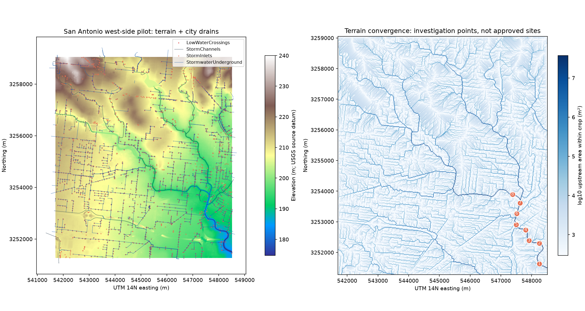

# Flood Decongestion Model

**San Antonio Flood Lab — UTSA datathon prototype**

A reproducible prototype for investigating stormwater collection opportunities in San Antonio. It combines public elevation and drainage data, transparent runoff-storage scenarios, and AI-assisted review of historical Texas flood imagery.

**Start here:** [Executed notebook](SanAntonio_Flood_Planning.ipynb) · [Presentation script](DEMO_SCRIPT.md) · [Detailed instructions](START_HERE.md)



## What the project does

1. Audits the supplied flood-image metadata and its geographic coverage.
2. Loads real USGS elevation and City of San Antonio drainage data for a west-side pilot area.
3. Uses terrain flow accumulation, a slope filter and spacing to identify eight investigation points.
4. Compares assumed rainfall, runoff coefficients and collector-storage capacities while avoiding double counting along drainage paths.
5. Uses an OpenAI-compatible vision API to compare three historical before/after image pairs. Actual model responses are cached with provenance.

The output is **preliminary screening**, not an engineering design or a claim that these locations are optimal or buildable.

## Review the demo without an API key

- Open the [executed notebook](SanAntonio_Flood_Planning.ipynb) on GitHub to inspect the workflow and saved outputs.
- Download this repository using **Code → Download ZIP**, extract it, and open `FloodLab_Report.html` in a browser. The report includes interactive rainfall/storage controls and the actual cached AI analyses. GitHub's file view does not execute the HTML report.
- Review [candidate coordinates](results/candidate_screening.csv), [scenario results](results/storage_scenarios.csv), and [API evidence](results/api_evidence/).

The public input subset needed for the demo is included under `data/`. No GPU or API credential is needed to reproduce the baseline from those inputs.

## Run it

Use Python 3.11 or later in a virtual environment:

```bash
git clone https://github.com/odalyschacon/Flood-Decongestion-Model.git
cd Flood-Decongestion-Model
python -m pip install -r requirements.txt
python run_analysis.py
python -m unittest discover -s tests -v
python -m jupyterlab SanAntonio_Flood_Planning.ipynb
```

On the original Windows laptop, `Launch_Notebook.cmd` uses the existing Anaconda environment named `gb10`. That environment name does not imply a hardware requirement. On another machine, use the commands above.

To refresh model observations while connected to the workshop network:

```bash
python api_evidence.py --refresh
python run_analysis.py
```

The script prompts for a key without saving it. For automation, set `FLOODLAB_API_KEY` in the process environment. `FLOODLAB_BASE_URL` and `FLOODLAB_MODEL` optionally override the configured endpoint and model. Credentials are not included in this repository.

## Data and implementation

| Component | Included implementation |
|---|---|
| Texas flood dataset | All 1,204 metadata rows, 273 fields, and six sample images forming three pairs |
| San Antonio terrain | USGS 3DEP raster, approximately 17 m cells in UTM zone 14N |
| City drainage | 3,563 inlets, 5,677 underground line features, 201 channels and 2 low-water crossings intersecting the pilot box |
| Terrain routing | Priority-flood drainage tree with cropped-domain outlets |
| Collector experiment | Event-volume accounting with upstream capture removed before downstream routing |
| AI evidence | Three successful `qwen3-vl-8b-instruct` image-pair analyses through the provided OpenAI-compatible API |
| Outputs | Executed notebook, offline interactive report, candidate CSV/GeoJSON, scenario CSV and provenance records |

For an illustrative 50 mm event, runoff coefficient 0.60 and eight collectors with 2,000 m³ each, the model captures **16,000 m³**. This is a conditional storage-volume result, not a measured reduction in flood damage or homes affected.

## Validation and limitations

- All nine nonempty notebook code cells executed successfully.
- Four tests cover water-volume conservation, cascaded collectors, coordinate conversion and rainfall interval validation.
- The report's 16 preset interactive scenarios were compared with Python outputs.
- Three API image analyses completed successfully; they remain unreviewed model observations, not human labels.

**Geography:** The provided flood imagery covers Houston and Hill Country, not San Antonio. Its AI review demonstrates evidence gathering; it does not validate San Antonio flood risk or determine the site ranking.

**Hydrology:** The pilot is a cropped rectangle, not a complete watershed. External inflows, inlet-rate limits, sewer capacity, backwater, drawdown and flood depth are not modeled. The storage calculation is an optimistic volume bound.

**Construction:** Building footprints, residential exposure, parcels, soils, utility conflicts and land feasibility are not yet included. Tunnel routes and new-construction suitability require those inputs and a calibrated hydraulic model such as EPA SWMM with surface-flow modeling where needed.

**Earth-2:** Part of the initial concept, but not run or used in the final demo. `earth2_forecast.py` is an optional future integration, not a tested component or a requirement. Current rainfall is explicitly scenario-based.

## Project structure

```text
SanAntonio_Flood_Planning.ipynb   Executed walkthrough
FloodLab_Report.html             Offline interactive report
api_evidence.py                  Authenticated image comparison and caching
floodlab.py / geo.py             Terrain, storage and coordinate calculations
run_analysis.py                  Regenerate report and exports
fetch_data.py                    Reproduce public input downloads
data/                           Cached public inputs and source records
results/                        Computed outputs and actual AI responses
tests/                          Calculation checks
workshop/                       Attributed upstream teaching materials
```

## Sources, attribution and license

This project builds on [Jennifer Fowler's GB10 competition materials](https://github.com/jennifer-fowler/GB10competition), reviewed at commit `fb2e297`. The upstream teaching materials are preserved separately in `workshop/`; unfinished upstream experiments are not part of the tested application. See [the repository review](REPOSITORY_REVIEW.md).

- [UTSA flood images](https://huggingface.co/datasets/jennifer-fowler/UTSA-flood-images), revision `ad98e681e7cf6af9ced145833b522c4f6c0acad1`.
- [City of San Antonio GIS](https://www.sanantonio.gov/GIS/GISdata).
- [USGS 3DEP elevation service](https://elevation.nationalmap.gov/arcgis/rest/services/3DEPElevation/ImageServer).
- [OpenAI Python SDK](https://developers.openai.com/api/reference/python), used to call the supplied Qwen endpoint, not an OpenAI-hosted model.

Code is distributed under [GPL-3.0](LICENSE). The Hugging Face dataset card specifies **CC BY-NC 4.0**; data are not relicensed as GPL. Preserve agency attribution and each source's terms. Download provenance and hashes accompany the cached data. Current infrastructure snapshots do not reconstruct historical conditions.
